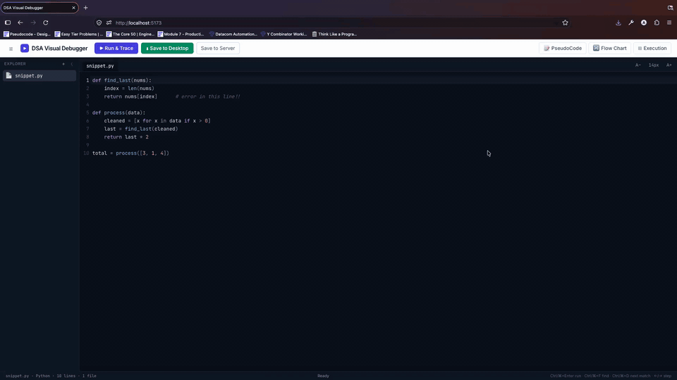
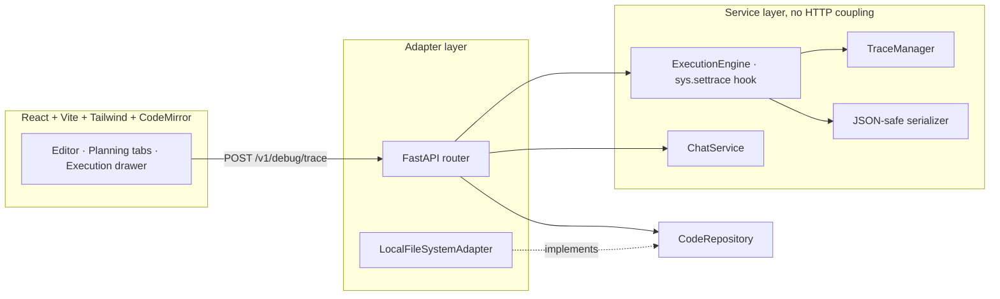

# DSA Visual Debugger

A web app for learning Python data structures and algorithms. Paste a
function, run it, then step forward and backward through its execution to see
how variables change and how the call stack moves.



> **Live demo:** <https://anmol-shrestha.github.io/dsa-visual-debugger/> — a
> static build with pre-recorded traces (bubble sort, two sum, linked-list
> reversal). Clone the repo to trace your own code with the backend.

## Try it yourself ( Paste the following prompt)

Paste this into **Claude Code** (or any Claude setup that can run commands on
your computer). It works on macOS, Windows, and Linux: Claude detects your
system and uses the matching commands.

```text
I want to run the DSA Visual Debugger on my computer.
Repo: https://github.com/Anmol-Shrestha/dsa-visual-debugger

1. Detect my operating system (macOS, Windows, or Linux) and use the matching commands.
2. Check the prerequisites: git, Python 3.11+ (python3 on macOS/Linux, py -3 on Windows), and Node.js 18+ with npm. If something is missing, tell me what to install and ask before installing anything.
3. Clone https://github.com/Anmol-Shrestha/dsa-visual-debugger into ~/dsa-visual-debugger. If the folder already exists, pull the latest main instead.
4. Backend: in backend/, create a venv, install requirements.txt, and start `uvicorn main:app --port 8000` in the background with its output written to a log file.
5. Frontend: in frontend/, run `npm install`, then start `npm run dev -- --port 5173` in the background.
6. Check that http://localhost:8000/v1/health returns {"status":"ok"} and that http://localhost:5173 responds. Retry for up to 60 seconds.
7. Open http://localhost:5173 in my default browser.
8. Tell me how to stop both servers.

Rules: ask before installing software or deleting anything. Don't use sudo. Don't change any files in the repo. This app runs the Python code I paste into it on my own computer, so only run the steps above.
```

Keep this window open while you use the app. When you're done, ask Claude to stop the servers.


## What it does today

**Code editor**
- CodeMirror 6 editor with Python syntax highlighting.
- Enter keeps indentation, and adds a level after a line ending in `:`. Tab inserts 4 spaces.
- Search (Ctrl/⌘+F), select next match (Ctrl/⌘+D), multi-cursor (Alt+Ctrl/⌘+↑/↓), and zoom (Ctrl/⌘+=/−/0).
- Multiple files in a collapsible explorer, kept in your browser.

**Planning tools**
- **PseudoCode:** a plain-language notepad. "Insert as comments" adds it to the top of the editor as `#` lines.
- **Flow Chart:** a drag-and-drop canvas with process, decision, input/output, and start/end shapes.
- Both open as browser-style tabs beside the editor, and both are saved in your browser.

**Run and debug**
- **Run & Trace** (Ctrl/⌘+Enter) executes the code once and records every line: the current line, the call stack, and a snapshot of local variables.
- **Step through the timeline** with a slider or the ←/→ keys. Variables that changed since the previous step are highlighted. Lists and dictionaries are shown as visual blocks.
- **Errors** show the error type, message, and line number. The stack trace lists each function call that led to the error. Click a frame to highlight the expression that failed in the editor.

**Saving**
- **Save to Desktop** (Ctrl/⌘+S) downloads the current file as a `.py` file.
- **Save to Server** stores a snippet through the backend (needs the backend running).

**Layout**
- Resizable panels, and a bottom drawer for console output and the stack trace.
- Ctrl/⌘+B hides the explorer, and Ctrl/⌘+\` hides the drawer.

## How it works

The backend runs the submitted code once under a `sys.settrace` hook and
returns the full timeline as JSON. The frontend keeps that timeline in memory,
so stepping forward and backward is instant and needs no further requests.



The design decisions are recorded in [`ARCHITECTURAL_DECISION.md`](ARCHITECTURAL_DECISION.md).


## Running locally

**Backend** (Python 3.11+):

```bash
cd backend
python -m venv venv && source venv/bin/activate
pip install -r requirements.txt
uvicorn main:app --reload          # http://localhost:8000
```

**Frontend** (Node 18+):

```bash
cd frontend
npm install
npm run dev                        # http://localhost:5173 (proxies /v1 to the backend)
```

**Tests:**

```bash
cd backend && python -m pytest tests -q
```

## API

| Endpoint | Purpose |
|---|---|
| `POST /v1/debug/trace` | Run a snippet and return the full step timeline |
| `POST /v1/code/save` | Save a snippet through the repository |
| `GET /v1/code/{id}` | Load a saved snippet |
| `GET /v1/health` | Liveness check |
| `GET /v1/chat/providers` | List chat models and whether each is configured (no UI yet) |
| `POST /v1/chat` | Ask a chat model about code (no UI yet) |

## Security

The tracer's limits (step count, call depth, and a time limit) guard against
runaway code, but they are not an operating-system sandbox. Submitted code
runs with the server's privileges. That's fine on your own machine, which is
how the app is meant to run. A public deployment would need per-run process
isolation first, so the public demo is a static build with pre-recorded traces.
